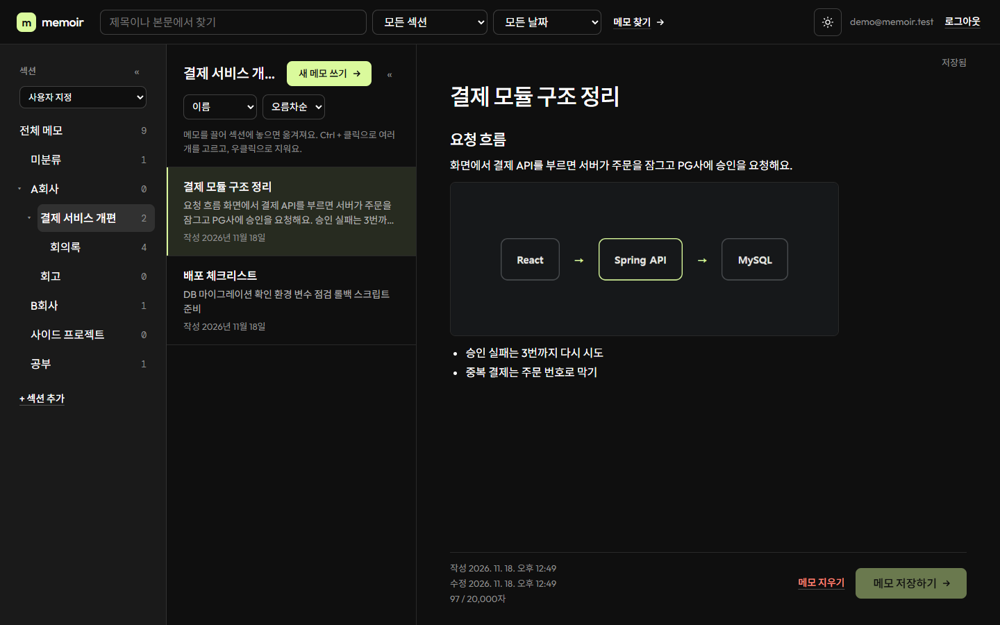
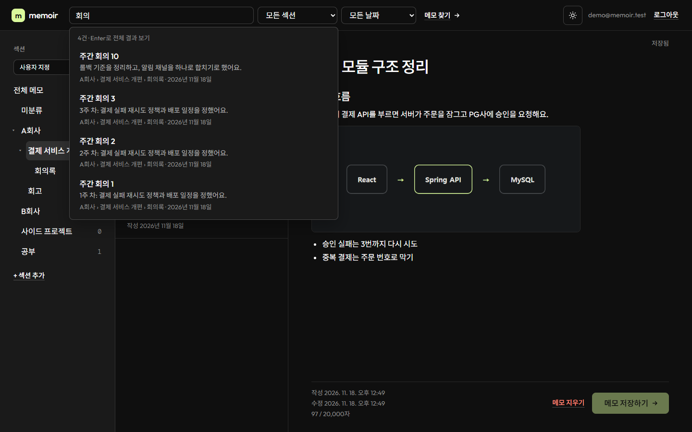

# memoir

[](https://github.com/iokl1004/memoir/actions/workflows/ci.yml)

섹션을 트리로 나눠 쓰고, 키워드와 작성일로 다시 찾는 개인 메모 웹앱이에요.

> 처음에는 Spring Boot + MySQL로 만들었고, 무료 배포 문제로 **Supabase + Vercel로 옮겼어요.**
> 왜, 어떻게 옮겼는지는 [docs/migration-to-supabase.md](docs/migration-to-supabase.md)에 정리했어요.
> Spring 버전의 마지막 코드는 커밋 [`3fc7d07`](https://github.com/iokl1004/memoir/tree/3fc7d07)에서 볼 수 있어요.



| 입력하는 동안 검색 결과 미리보기 | 휴대폰: 섹션 서랍 | 휴대폰: 길게 눌러 여러 개 고르기 |
|---|---|---|
|  |  |  |

- **섹션 트리**: 회사 › 프로젝트 › 회의처럼 단계 제한 없이 나눠요. 끌어서 다른 섹션 안이나 옆으로 옮기고, 이름·만든 날짜·직접 정한 순서로 정렬해요. 우클릭 메뉴로 하위 섹션 만들기, 이름 바꾸기, 지우기를 해요.
- **검색**: 제목과 본문에서 여러 단어를 함께 찾고, 섹션과 작성일 기간으로 좁혀요. 입력하는 동안 검색창 아래에 결과를 10건씩 미리 보여줘요.
- **정렬**: 이름(숫자는 크기 순서: 9 → 10 → 22), 수정한 날짜, 만든 날짜(오름·내림차순), 직접 정한 순서(끌기 또는 Alt + ↑↓)
- **메모 옮기기**: 목록의 메모를 끌어 사이드바 섹션에 놓으면 그 섹션으로 옮겨져요. Ctrl + 클릭(휴대폰은 길게 누르기)으로 여러 개를 골라 한 번에 옮기거나 지워요.
- **편집**: 글자와 그림을 함께 쓰는 편집기. 캡처한 그림을 붙여넣거나 끌어 놓으면 바로 들어가고, 크기를 조절해요(한 장 5MB, 큰 그림은 올리기 전에 자동으로 줄여요). 저장하지 않고 떠나면 경고, Ctrl + S 저장
- **그림 저장 공간**: 한 사람에 50MB. 계정 창에서 얼마나 썼는지 보여줘요.
- **화면**: 섹션과 메모 목록 칸의 넓이를 끌어서 바꾸고, 접었다 펼 수 있어요.
- **휴대폰**: 섹션은 왼쪽 서랍으로, 섹션 메뉴는 길게 누르기로, 고른 메모는 아래쪽 막대에서 옮기거나 지워요.
- **계정**: 패스워드 찾기(메일로 30분짜리 1회용 링크), 패스워드 변경, 계정 삭제. 가입·로그인·패스워드 찾기에는 보이지 않는 캡차(Cloudflare Turnstile Invisible)가 붙어요. 화면에는 아무것도 나오지 않아요.
- **라이트/다크 모드**

## 🛠 문제 해결 기록

### 1. 검색이 가장 느릴 때 1.3초 → 27ms (메모 50만 건)
Spring + MySQL 시절, 사용자 5명 × 메모 10만 건을 넣고 LIKE와 FULLTEXT(ngram) 검색을 실제 HTTP로 비교했어요.
- FULLTEXT는 드문 단어에서 15배, 없는 단어에서 37배 빨랐지만, 흔한 단어는 6배, 섹션·기간 조건을 함께 걸면 31~66배 느렸어요. `EXPLAIN ANALYZE`로 보니 FULLTEXT 인덱스에 `user_id`가 없어서, 모든 사용자의 일치 26만 건을 꺼낸 뒤 내 것만 거르고 정렬하고 있었어요.
- LIKE의 비용은 검색이 아니라 전체 건수 COUNT에서 나왔어요. 첫 페이지 20건은 0.15ms인데 건수를 세는 데 216ms가 들었어요.
- 그래서 **건수는 1,000건까지만 세고**, 조건과 단어 빈도를 보고 **LIKE와 FULLTEXT 중 빠른 쪽을 고르게** 했더니 가장 느린 검색이 1,337ms에서 27ms가 됐어요.
- 측정 중에 ngram 기본 불용어 때문에 `data`를 검색하면 0건이 나오는 함정도 찾아서 인덱스에서 불용어를 껐어요.

지금의 Postgres 버전도 건수를 1,000건까지만 세는 방식을 그대로 이어받았어요. 전체 측정 기록: [bench/README.md (Spring 버전)](https://github.com/iokl1004/memoir/blob/3fc7d07/bench/README.md)

### 2. 무료로 띄울 서버가 없었어요
Oracle Cloud 무료 VM을 한국 리전에서 받지 못했고, 일본 리전은 한 번 정하면 바꿀 수 없는 홈 리전이 부담이었어요. 방법들을 비교한 뒤 Spring을 내려놓고 Supabase(서울) + Vercel로 옮겼어요. 권한 검사는 RLS와 트리거로, 그림은 Storage와 서명 주소로 다시 설계했어요. 자세한 비교와 잃은 것, 얻은 것: [docs/migration-to-supabase.md](docs/migration-to-supabase.md)

### 3. GitHub이 로컬 테스트 키를 비밀 값으로 막았어요
통합 테스트에 로컬 Supabase의 기본 Secret key를 적었더니 GitHub Push Protection이 푸시를 거절했어요. 로컬 전용 값이어도 실제 키와 형식이 같기 때문이에요. 키를 코드에 적지 않고 테스트가 시작할 때 `supabase status -o env`에서 읽어 오게 바꿨어요(`frontend/db-tests/helpers.ts`). CI도 같은 방식으로 돌아요.

## 기술 스택

| | |
|---|---|
| 화면 | React 19, TypeScript, Vite, TipTap(편집기) — Vercel |
| 백엔드 | Supabase: Postgres 17(테이블, RLS, PL/pgSQL 함수), Auth, Storage, Edge Functions(Deno) — 서울 리전 |
| 테스트 | 단위: Vitest — 9개 / 통합: 로컬 Supabase에 Vitest — 13개(RLS, DB 함수, Edge Function, Auth) |
| CI | GitHub Actions — push마다 화면 린트·테스트·빌드, 로컬 Supabase를 띄워 통합 테스트 |
| 운영 | GitHub Actions가 매일 고아 그림 청소, DB·그림 백업(암호화) |

## 구조

```
supabase/
 ├─ migrations/        테이블·RLS(1), 섹션·메모·검색 함수(2), 그림 버킷(3), 계정 삭제용 패스워드 확인(4), 개수 제한·search_path(5)
 ├─ functions/
 │   ├─ upload-image     그림 올리기: 형식 확인, 5MB·50MB 한도
 │   ├─ delete-account   패스워드 확인 → 그림 파일 → 계정(표는 연쇄 삭제)
 │   └─ cleanup-images   하루 지난 고아 그림 지우기 (매일 Actions가 불러요)
 ├─ templates/         패스워드 찾기 메일
 └─ config.toml        로컬 설정 (패스워드 8자 이상, 현재 패스워드 확인, 메일 1분 간격, 캡차)
frontend/src
 ├─ api.ts          Supabase 호출과 오류 문구 (화면은 예전 API 모양 그대로 써요)
 ├─ images.ts       그림 줄이기, "/img/번호" ↔ 서명 주소 바꾸기
 ├─ Workspace.tsx   화면 상태와 세 칸 배치
 ├─ SectionNav.tsx  섹션 트리 (끌기, 우클릭·길게 누르기 메뉴, 서랍)
 ├─ MemoList.tsx    메모 목록 (끌기, 여러 개 고르기)
 ├─ SearchBar.tsx   검색창과 결과 미리보기
 ├─ MemoEditor.tsx  TipTap 편집기 (처음 열 때 불러와요)
 └─ sectionTree.ts  평평한 섹션 목록 → 트리, 정렬
frontend/db-tests  로컬 Supabase에 대고 도는 통합 테스트
```

설계에서 신경 쓴 점
- **모든 테이블에 RLS**: `user_id = auth.uid()`인 줄만 보이고 바뀌어요. 화면이 표를 직접 고쳐도, DB 함수 안에서도 남의 줄은 보이지 않아요. 프로젝트 설정에서 "새 테이블은 RLS 자동 켜기, API 자동 공개 끄기"로 두고, 필요한 권한만 마이그레이션에서 열었어요.
- 메모의 `(section_id, user_id)` 복합 FK로, 다른 사람의 섹션에 메모가 들어가는 일을 DB가 막아요.
- **규칙은 트리거로**: 미분류 섹션 보호, 미분류 안에 섹션 금지, 섹션 순환 금지는 트리거가 지켜요. 함수를 거치지 않고 표를 직접 고쳐도 지켜져요.
- 여러 줄을 함께 바꾸는 일(섹션 옮기기·지우기, 메모 여러 개 옮기기·지우기, 순서 바꾸기)은 PL/pgSQL 함수 하나 = 트랜잭션 하나예요. 하나라도 남의 메모가 섞이면 아무것도 바꾸지 않아요.
- **검색**: 모든 단어가 제목이나 본문에 있는 메모를 찾아요. 입력한 `%`, `_`는 글자 그대로 찾고, 다음 페이지 여부는 한 건 더 읽어서 알고, 전체 건수는 1,000건까지만 세요. 기간은 한국 날짜 기준이에요.
- 이름 정렬은 제목의 숫자를 12자리로 맞춘 값(`title_sort`, 트리거가 채움)으로 해서, 인덱스를 그대로 쓰면서도 9 → 10 → 22 순서가 돼요.
- **본문 HTML**: 편집기(TipTap)는 정해 둔 노드와 속성만 읽어서, 스크립트나 이벤트 속성은 화면에 들어오지 못해요. 메모는 주인만 볼 수 있어서 서버에서 따로 정리하지 않아요(공유 기능을 넣으면 서버 정리를 추가해야 해요).
- **그림**: 비공개 버킷에 `{user_id}/{번호}`로 저장하고, 본문에는 `/img/번호`만 적어요. 보여 줄 때 1시간짜리 서명 주소로 바꾸고, 같은 주소를 재사용해 브라우저 캐시를 살려요. 올리기는 Edge Function만 할 수 있어서 형식(파일 앞부분)과 크기, 한 사람 50MB 한도를 서버에서 확인해요. 올리기 전에 브라우저에서 긴 변 2,000px로 줄이고 PNG·JPEG 중 작은 쪽으로 바꿔요(휴대폰 사진의 위치 정보도 함께 빠져요).
- 본문에서 빠지거나 저장하지 않은 그림은 하루 뒤 청소 함수가 파일까지 지워요(Storage 파일은 SQL로 지우면 남아서 API로 지워요).
- **패스워드 찾기**는 가입하지 않은 이메일에도 똑같이 응답해요. 메일 링크는 `token_hash` 방식이라 다른 기기에서 열어도 되고, 바꾸면 모든 기기의 로그인을 끊어요. 로그인한 상태에서 바꿀 때는 현재 패스워드를 서버가 확인해요.
- 사용자 지정 순서는 1024 간격으로 번호를 매기고, 사이에 끼울 자리가 없을 때만 다시 매겨요.
- **남용 막기**: 무료 DB는 모두가 함께 써서, 한 사람에 메모 10,000개, 섹션 1,000개, 그림 50MB까지로 제한해요(트리거라서 표를 직접 고쳐도 지켜져요).
- **보안 헤더**(`frontend/vercel.json`): CSP로 스크립트는 이 사이트와 Cloudflare 캡차만, 연결은 Supabase만 허용해요. 로그인 정보가 브라우저 저장소에 있어서, 혹시 끼어든 스크립트가 다른 곳으로 보내지 못하게 막는 게 목적이에요. 다른 사이트의 iframe 안에는 뜨지 않아요.
- 모든 DB 함수는 `search_path`를 비워 두고 이름마다 스키마를 붙여 써요.

## 실행하기

Docker Desktop과 Node.js가 필요해요.

```bash
npx supabase start                # 로컬 Supabase (DB, Auth, Storage, 함수) — 마이그레이션도 적용돼요
cd frontend && npm install
npm run dev                       # 화면 :5173 (로컬 Supabase에 붙어요)
```

```bash
cd frontend
npm test                          # 단위 테스트
npm run test:db                   # 통합 테스트 (로컬 Supabase가 켜져 있어야 해요)
```

로컬에서 보낸 메일(패스워드 찾기)은 http://127.0.0.1:54324 (Mailpit)에서 볼 수 있어요.

## 배포하기 (Supabase + Vercel)

비밀 값은 저장소에 넣지 않아요. 아래 값들은 각 서비스의 설정 화면이나 `supabase secrets`로 넣어요.

1. **Supabase에 올리기**
   ```bash
   npx supabase login
   npx supabase link --project-ref <프로젝트 ref>
   npx supabase db push                      # 마이그레이션
   npx supabase functions deploy             # Edge Functions 3개
   npx supabase secrets set CLEANUP_SECRET=<긴 임의 값> IMAGE_QUOTA_MB=50
   ```
2. **Supabase 대시보드 설정** (Authentication)
   - URL Configuration: Site URL을 Vercel 주소로
   - Sign In / Providers → Email: Confirm email 끄기, "현재 패스워드 요구" 켜기, Secure password change는 끄기(켜면 메일 재인증이 필요해져요), 패스워드 최소 8자
   - Emails → SMTP: Gmail(`smtp.gmail.com:587`, memoir 전용 계정, 앱 비밀번호), 보내는 간격 60초
   - Emails → Templates → Reset password: `supabase/templates/recovery.html` 내용과 제목을 붙여넣기
   - Attack Protection: CAPTCHA 켜기(Turnstile, Secret Key)
3. **Vercel**: 저장소를 가져오고 Root Directory를 `frontend`로, 환경 변수 `VITE_SUPABASE_URL`, `VITE_SUPABASE_PUBLISHABLE_KEY`, `VITE_CAPTCHA_SITE_KEY`를 넣어요.
4. **GitHub Actions 비밀 값**: `.github/workflows/daily.yml` 맨 위에 적은 5개를 넣으면 매일 청소와 백업이 돌아요.

## 디자인

화면 디자인 시스템(색, 글꼴, 버튼, 움직임)은 [taste-skill](https://github.com/Leonxlnx/taste-skill)의 `system.css`와 `motion.css`를 썼어요(MIT, [라이선스](frontend/public/assets/LICENSE-taste-skill.txt)).
