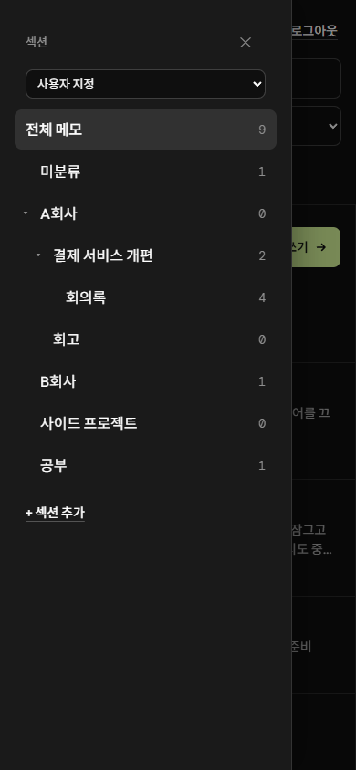
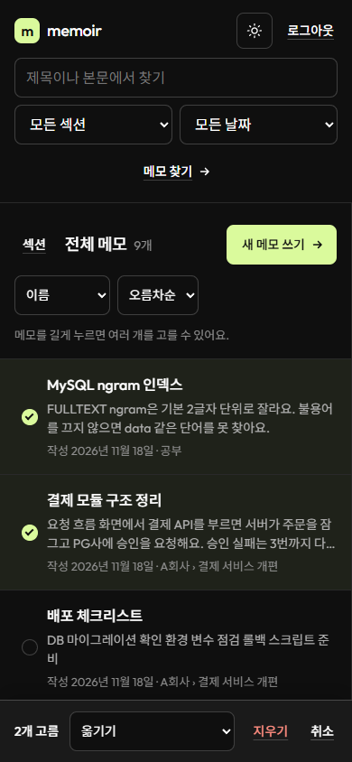

# memoir

[](https://github.com/iokl1004/memoir/actions/workflows/ci.yml)

섹션을 트리로 나눠 쓰고, 키워드와 작성일로 다시 찾는 개인 메모 웹앱이에요.


| 입력하는 동안 검색 결과 미리보기 | 휴대폰: 섹션 서랍 | 휴대폰: 길게 눌러 여러 개 고르기 |
|---|---|---|
|  |  |  |

- **섹션 트리**: 회사 › 프로젝트 › 회의처럼 단계 제한 없이 나눠요. 끌어서 다른 섹션 안이나 옆으로 옮기고, 이름·만든 날짜·직접 정한 순서로 정렬해요. 우클릭 메뉴로 하위 섹션 만들기, 이름 바꾸기, 지우기를 해요.
- **검색**: 제목과 본문에서 여러 단어를 함께 찾고, 섹션과 작성일 기간으로 좁혀요. 입력하는 동안 검색창 아래에 결과를 10건씩 미리 보여줘요.
- **정렬**: 이름(숫자는 크기 순서: 9 → 10 → 22), 수정한 날짜, 만든 날짜(오름·내림차순), 직접 정한 순서(끌기 또는 Alt + ↑↓)
- **메모 옮기기**: 목록의 메모를 끌어 사이드바 섹션에 놓으면 그 섹션으로 옮겨져요. Ctrl + 클릭(휴대폰은 길게 누르기)으로 여러 개를 골라 한 번에 옮기거나 지워요.
- **편집**: 글자와 그림을 함께 쓰는 편집기. 캡처한 그림을 붙여넣거나 끌어 놓으면 바로 들어가고, 크기를 조절해요(한 장 5MB, 큰 그림은 자동으로 줄여 저장). 저장하지 않고 떠나면 경고, Ctrl + S 저장
- **화면**: 섹션과 메모 목록 칸의 넓이를 끌어서 바꾸고, 접었다 펼 수 있어요.
- **휴대폰**: 섹션은 왼쪽 서랍으로, 섹션 메뉴는 길게 누르기로, 고른 메모는 아래쪽 막대에서 옮기거나 지워요.
- **계정**: 패스워드 찾기(메일로 30분짜리 1회용 링크), 패스워드 변경, 계정 지우기. 패스워드를 여러 번 틀리면 캡차로 사람인지 확인해요. 서버를 다시 켜도 로그인이 유지돼요(세션을 DB에 저장).
- **라이트/다크 모드**

## 검색 성능: 50만 건에서 가장 느린 검색 1,337ms → 27ms

메모 50만 건(사용자 5명 × 10만 건)으로 세 가지 방식을 실제 API로 쟀어요.

| 검색 | LIKE | FULLTEXT ngram | **지금 (auto)** |
|---|---:|---:|---:|
| 흔한 단어 | 213ms | 1,307ms | **19ms** |
| 드문 단어 | 259ms | 18ms | **27ms** |
| 없는 단어 | 222ms | 6ms | **12ms** |
| 흔한 단어 + 섹션 | 43ms | 1,337ms | **12ms** |

- **LIKE**는 비용 대부분이 검색이 아니라 전체 건수 `COUNT`에서 나왔어요.
- **FULLTEXT**는 인덱스에 `user_id`가 없어서, 흔한 단어는 모든 사용자의 일치 26만 건을 꺼내 정렬하느라 느렸어요.
- 그래서 **건수는 1,000건까지만 세고**, 검색할 때마다 **LIKE와 FULLTEXT 중 빠른 쪽을 골라요**. 최근 메모 2,000건에서 먼저 찾아보고 흔한 단어인지 판단해요.

측정 방법, 실행 계획(EXPLAIN ANALYZE), 찾은 함정(ngram 불용어 때문에 `data` 검색이 0건이 되는 문제 등)은 [bench/README.md](bench/README.md)에 있어요.

## 기술 스택

| | |
|---|---|
| 백엔드 | Java 21, Spring Boot 4.1, Spring Security(세션 + CSRF), Spring Session JDBC, Spring Data JPA, Flyway, jsoup, Spring Mail |
| DB | MySQL 8.4 (FULLTEXT ngram 인덱스) |
| 프론트엔드 | React 19, TypeScript, Vite, TipTap(편집기) |
| 테스트 | 백엔드: JUnit 5, Testcontainers(MySQL) — 91개 / 프론트엔드: Vitest — 9개 |
| CI | GitHub Actions — push마다 백엔드 테스트, 프론트엔드 린트·테스트·빌드 |
| 개발 환경 | Docker Compose (앱을 켜면 MySQL이 함께 떠요) |

## 구조

```
src/main/java/com/iokl1004/memoir
 ├─ auth      회원가입, 로그인 (세션), 로그인 시도 제한(캡차), 패스워드 찾기·변경, 계정 지우기, Security 설정
 ├─ section   섹션 트리: 만들기, 이름 바꾸기, 옮기기, 지우기(하위 섹션과 메모까지)
 └─ memo      메모 CRUD, 사용자 지정 순서, 본문 HTML 정리(jsoup), 그림 올리기
     └─ search  MemoSearcher 인터페이스 — LIKE / FULLTEXT / auto(기본값)
src/main/java/db/migration         Flyway Java 마이그레이션 (V8: 기존 메모의 이름 정렬 값 채우기)
src/main/resources/db/migration   Flyway V1~V11
frontend/src
 ├─ Workspace.tsx   화면 상태와 세 칸 배치
 ├─ SectionNav.tsx  섹션 트리 (끌기, 우클릭·길게 누르기 메뉴, 서랍)
 ├─ MemoList.tsx    메모 목록 (끌기, 여러 개 고르기)
 ├─ SearchBar.tsx   검색창과 결과 미리보기
 ├─ MemoEditor.tsx  TipTap 편집기 (처음 열 때 불러와요)
 └─ sectionTree.ts  평평한 섹션 목록 → 트리, 정렬 (Vitest로 테스트)
bench/                             검색 성능 측정 도구와 결과
```

설계에서 신경 쓴 점
- 메모의 `(section_id, user_id)` 복합 FK로, 다른 사람의 섹션에 메모가 들어가는 일을 DB가 막아요.
- 다른 사람의 메모나 섹션은 "없음"(404)으로 응답해서 존재 여부도 알 수 없게 해요.
- 섹션 삭제(하위 섹션 + 안의 메모)와 섹션 이동(순환 검사)은 한 트랜잭션으로 처리해요.
- 본문 HTML은 서버에서 jsoup으로 정리해요(스크립트·이벤트 속성·바깥 그림 제거). 검색은 HTML이 아니라 뽑아낸 글자로 해서 태그 이름이 검색되지 않아요.
- 그림은 파일 앞부분으로 형식을 확인하고(PNG·JPEG·GIF·WebP만), 올린 사람만 볼 수 있어요. 메모를 지우면 DB가 그림도 함께 지워요.
- 이름 정렬은 제목의 숫자를 12자리로 맞춘 값(`title_sort`)으로 해서, 인덱스를 그대로 쓰면서도 9 → 10 → 22 순서가 돼요.
- 여러 메모를 옮기거나 지울 때는 한 요청으로 처리하고, 하나라도 남의 메모가 섞이면 아무것도 바꾸지 않아요.
- 그림은 긴 변 2,000px로 줄이고 PNG·JPEG 중 작은 쪽으로 저장해요. 본문에서 빠지거나 저장하지 않은 그림은 하루 뒤 정리 작업(`@Scheduled`)이 지워요.
- 패스워드 찾기는 가입하지 않은 이메일에도 똑같이 응답하고, 메일은 따로(@Async) 보내서 응답 시간으로도 가입 여부가 드러나지 않아요. 링크 토큰은 해시만 저장하고, 패스워드를 바꾸면 다른 기기의 로그인을 모두 끊어요.
- 로그인 시도 제한은 잠그지 않고 캡차(Cloudflare Turnstile)로 해요. 같은 계정을 15분 안에 5번 틀리면, 또는 한 접속 주소에서 20번 틀리면 그다음부터 캡차를 풀어야 다시 시도할 수 있어요. 캡차가 필요하면 패스워드를 확인하지도 않고, 가입하지 않은 이메일도 똑같이 세서 가입 여부가 드러나지 않아요. 캡차 스크립트는 캡차가 필요할 때만 불러와요.
- 남용 막기: 한 접속 주소에서 15분 안에 가입을 5번 넘게 하면 캡차를 풀어야 해요. 그림은 한 사람에 200MB까지 저장해요(무료 DB 보호).
- 사용자 지정 순서는 1024 간격으로 번호를 매기고, 사이에 끼울 자리가 없을 때만 다시 매겨요.

## 실행하기

Docker Desktop, Java 21, Node.js가 필요해요.

```bash
./gradlew bootRun                 # API 서버 :8080 (MySQL은 Docker로 자동 실행)
./gradlew bootJar                 # 화면까지 든 실행 파일 build/libs/memoir.jar
cd frontend && npm install && npm run dev   # 화면 :5173 (/api 요청은 8080으로 전달)
```

```bash
./gradlew test                    # 통합 테스트 (Testcontainers가 MySQL을 띄워요)
cd frontend && npm test           # 프론트엔드 테스트 (Vitest)
```

## 배포하기 (Docker)

`deploy/`에 앱 + MySQL + Caddy(HTTPS)를 한 번에 띄우는 묶음이 있어요. 화면(React)은 jar 안에 들어 있어서 서버에는 이 저장소만 있으면 돼요. Oracle Cloud ARM 서버처럼 CPU가 달라도 서버에서 직접 빌드하니 그대로 돌아가요.

1. 서버에 Docker를 설치하고, 방화벽에서 80·443 포트를 열어요. 도메인의 DNS가 서버 IP를 가리키게 해요.
2. 저장소를 받고 설정을 채워요.
   ```bash
   git clone https://github.com/iokl1004/memoir.git && cd memoir/deploy
   cp .env.example .env    # DOMAIN, DB 패스워드, 메일, 캡차 키
   docker compose up -d --build
   ```
   Caddy가 HTTPS 인증서를 자동으로 받아요. 앱은 `prod` 설정으로 뜨고, 처음 뜰 때 Flyway가 DB 테이블을 만들어요.
3. DB 백업을 매일 돌려요(최근 7일치 보관, 되살리는 방법은 `deploy/backup.sh` 안에 있어요).
   ```bash
   crontab -e
   0 3 * * * /home/ubuntu/memoir/deploy/backup.sh >> /home/ubuntu/memoir/deploy/backups/backup.log 2>&1
   ```
   백업은 같은 서버 디스크에 남아서, 서버가 통째로 망가지면 함께 사라져요. 가끔 내려받아 두거나 Oracle Object Storage(무료 20GB)에 복사해 두면 안전해요.
4. 새 버전을 올릴 때: `git pull && docker compose up -d --build`

배포용 설정(`application-prod.properties`): 로그인 쿠키는 HTTPS로만(Secure, HttpOnly, SameSite=Lax), 오류 응답에 내부 정보 숨김, 메일 링크 주소(APP_URL)가 없으면 시작하지 않음, 시간대는 한국 시간.

## 패스워드 찾기 메일 (Gmail)

메일 설정이 없으면 재설정 링크를 서버 로그에 남겨요(개발용). 실제로 보내려면 memoir 전용 Gmail 계정에서 **2단계 인증을 켜고 앱 비밀번호**를 만든 뒤, 아래 환경 변수로 넣어요. 앱 비밀번호는 코드나 저장소에 넣지 않아요.

```bash
SPRING_MAIL_HOST=smtp.gmail.com
SPRING_MAIL_PORT=587
SPRING_MAIL_USERNAME=memoir전용계정@gmail.com
SPRING_MAIL_PASSWORD=앱패스워드16자리
MAIL_FROM=memoir전용계정@gmail.com
APP_URL=http://localhost:5173        # 메일 속 링크의 주소. 배포하면 실제 주소로
```

## 캡차 (Cloudflare Turnstile)

키를 넣지 않으면 Cloudflare가 주는 **테스트 키**(항상 통과, 위젯에 "테스트 전용" 문구)를 써요. 실제로 쓰려면 Cloudflare 대시보드 → Turnstile에서 사이트를 추가하고(무료) 받은 두 키를 환경 변수로 넣어요.

```bash
CAPTCHA_SITE_KEY=0x...      # 화면에 보이는 키
CAPTCHA_SECRET_KEY=0x...    # 서버만 아는 키. 저장소에 넣지 않아요
```

## 디자인

화면 디자인 시스템(색, 글꼴, 버튼, 움직임)은 [taste-skill](https://github.com/Leonxlnx/taste-skill)의 `system.css`와 `motion.css`를 썼어요(MIT, [라이선스](frontend/public/assets/LICENSE-taste-skill.txt)).
